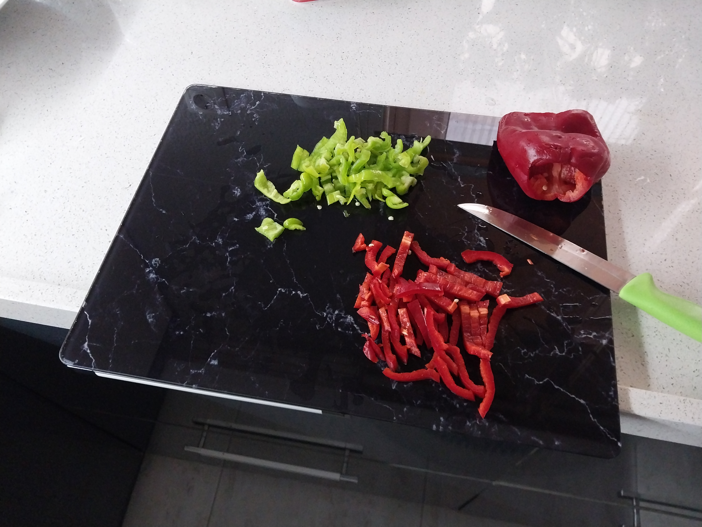
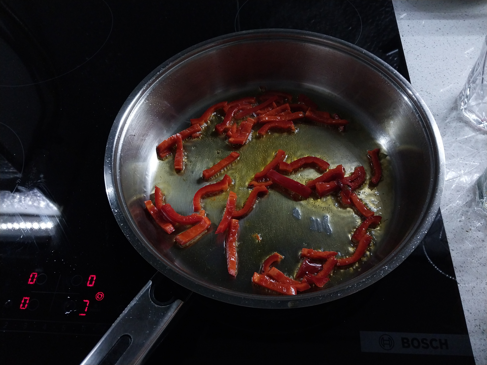
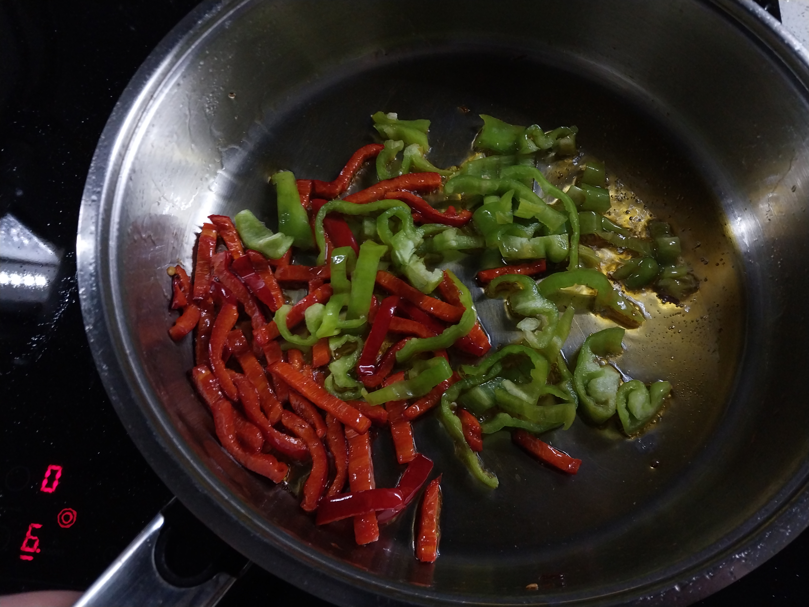
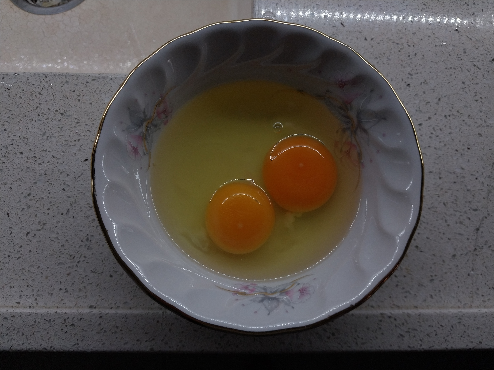
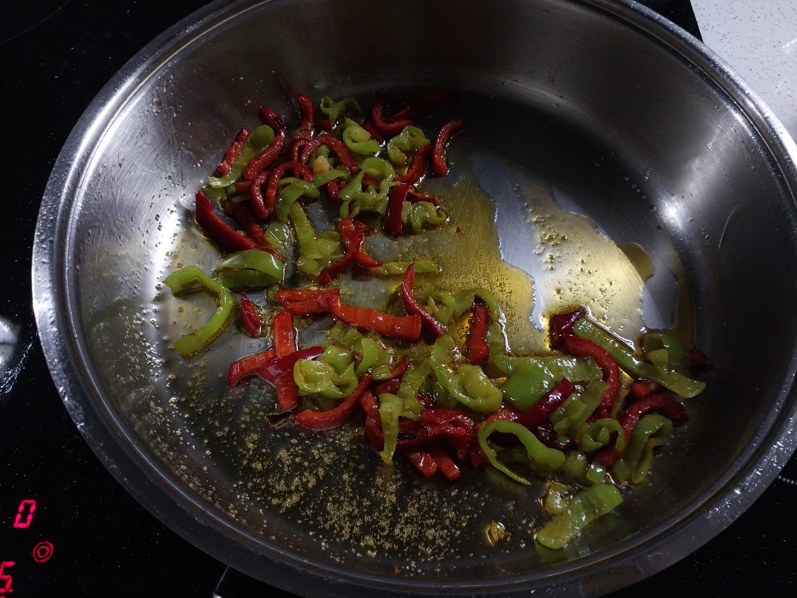
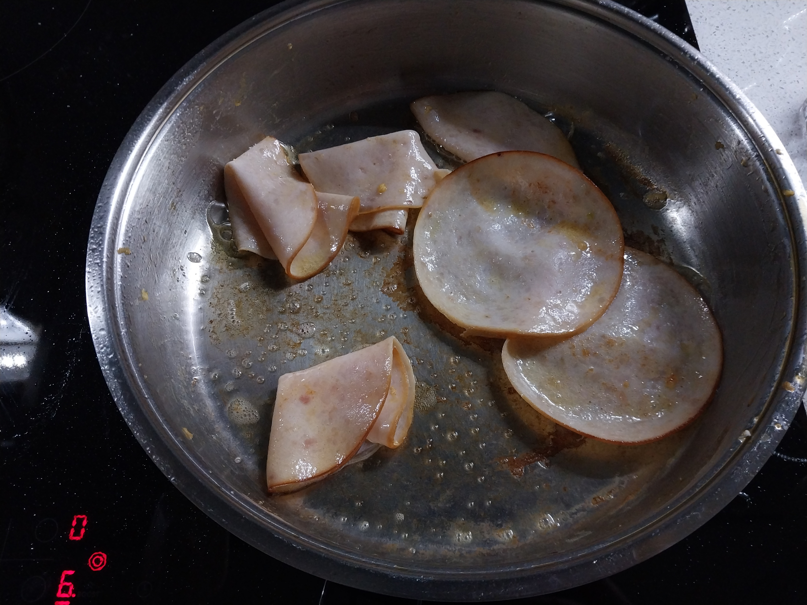
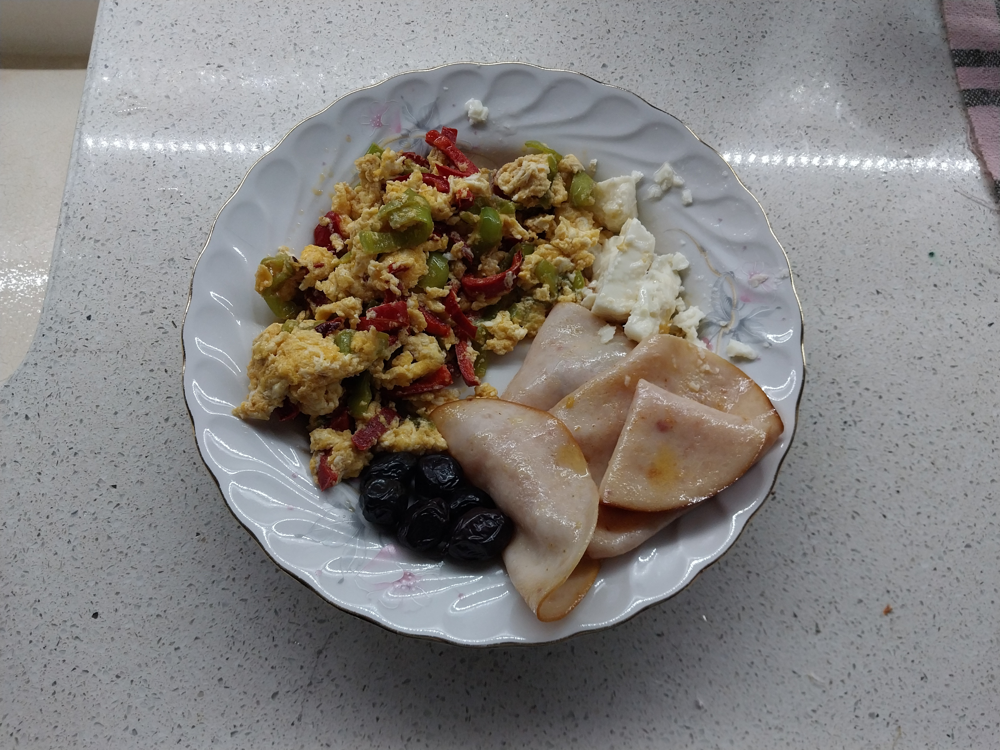

## Tarif Hakkında

&emsp;Kolayca ve hızlıca bir şeyler yemeniz gerktiğinde yapabileceğiniz biberli yumurta tarifi karşınızda!

  

## Tarif Özeti

1 - Çelik tavayı ısıt.

2 - Biberleri doğra.

3 - Önce kırmızı, sonra yeşil biberi pişir.

4 - Tuzu ve yumurtaları ekle.

5 - Afiyet olsun!

  

## Tarif

- Çelik tavanın ısınması için altını orta-yüksek derecede aç. Tava ısınırken biberleri eşit hacimde olacak şekilde şerit şerit doğra. Kırmızı biberler daha kalın olduğundan daha ince şeritler halinde kesilmeleri gerekir. Bu sayede iki biber türü de eşit zamanda pişer.

*Uygun büyüklükte doğranmış biberler*

- Çelik tavanın yeterince ısınması çok önemli. Bunu anlamanın en kolay yolu elinizi musluğun altında ıslatıp tavanın üstüne elinizdeki suları sıçratıp suları gözlemlemek. Eğer sular tavanın zeminine yapışıp hızlıca buharlaşıyorsa tava yeterince ısınmamıştır. Eğer sular küçük topcuklar halinde tavada geziniyorsa yeterince sıcaktır.

- Tava yeterince ısındıysa ısıyı orta dereceye düşür ve sıvı yağı tavaya ekle. İlk önce kırmızı biberleri tavaya at ve arada karıştır.

*Kırmızı biberler tavada*

- Karıştırırken biberlerin yavaştan yumuşamaya başladığını hissettiğin anda yeşil biberleri ekle. Yine ara ara karıştırmaya devam et.

*Kırmızı ve yeşil biberler tavada*

- Biberler pişerken, küçük bir kase içerisinde yumurtaları kır. Ayrı kase diyorum çünkü eğer yumurtaları direkt tavaya kırdığında bozuk yumurta varsa tüm emeğin çöpe gider. Ayrıca çelik tava çok hızlı pişirdiğinden dolayı eğer ikinci yumurtayı kırmakta yavaş kalırsan yumurtanın biri çok pişmişken diğer yumurta hala çiğ olur. Bundan dolayı da karışımı daha fazla pişirmek zorunda kalırsın.

*Yumurtalar*

- Biberler piştikten sonra tuzu ekle. Eğer tuzu erken eklersen fizik kanunları gereği biberlerin içindeki su hızlıca dışarı çıkıp biberlerin kuru ve sert olmasına sebep olur.

*Pişmiş ve tuzları eklenmiş biberler*

*Pişmiş biberli yumurta*

- Tercih edersen, yine aynı tava içerisinde herhangi bir salamı ince dilimler halinde 2 dakika ters düz ederek pişir. Piştiklerini düşündüğün an üzerine yarım kaşık tereyağı ekle. Bu sayede protein alımını hızlıca çeşitlendirmiş olursun.

*Tercihen pişirilen salam*

- Servis sırasında biberli yumurtanın yanına biraz peynir, zeytin ekleyerek öğünü tamamlayabilirsin. Afiyet olsun!

*Afiyet olsun.*
